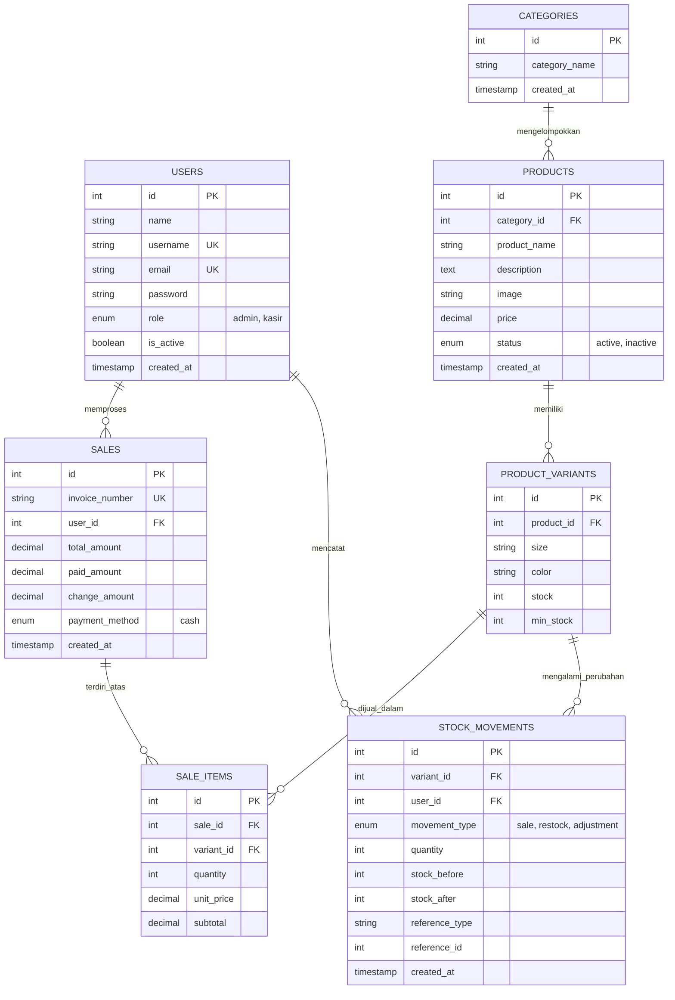

# 👗 Yunda Fashion POS & Inventory Monitoring System
### *Sistem Kasir & Monitoring Stok Berbasis Web dengan Konsep Digital Twin*

<p align="center">
  
  
  
  
  
  
</p>

---

## 📌 Informasi Proyek

* **Mata Kuliah:** Manajemen Proyek Perangkat Lunak (MPPL)
* **Studi Kasus:** UMKM Toko Pakaian Wanita **Yunda Fashion**
* **Kelompok:** 1 (Satu)
* **Metode Pengembangan:** Agile Scrum
* **Versi Dokumen PRD:** 1.0 (Rancangan Awal)
* **Repository:** [https://github.com/MPPL01022026/KELOMPOK1](https://github.com/MPPL01022026/KELOMPOK1)

---

## 👥 Identitas & Pembagian Peran Kelompok

| No | Foto / Inisial | Nama Anggota | NIM | Peran (Role) |
|:--:|:---:|:---|:---:|:---|
| 1 | 👑 | **Adit Apriansyah** | `230504130` | **Project Manager & Database Developer** |
| 2 | 💻 | **Arya Arfanda** | `230504128` | **Backend Developer & POS** |
| 3 | 🎨 | **Rana Shofa** | `230504106` | **Frontend Developer & UI/UX Designer** |
| 4 | 📦 | **Salsabila** | `230504097` | **Inventory & Reporting Developer / QA** | 

---

## 📖 Latar Belakang & Deskripsi Produk

**Yunda Fashion** merupakan usaha mikro, kecil, dan menengah (UMKM) yang bergerak dalam penjualan pakaian wanita dengan variasi produk seperti *kemeja, blus, gamis, rok, celana jeans, celana kain, manset, dan legging*.

Setiap pakaian memiliki kombinasi variasi **ukuran (size)** dan **warna (color)** yang beragam. Sistem pencatatan manual seringkali menimbulkan kendala:
1. Ketidaksesuaian jumlah stok fisik dengan catatan pembukuan.
2. Keterlambatan mengetahui persediaan produk yang mendekati habis.
3. Pemilik toko harus datang langsung ke lokasi fisik untuk memeriksa ketersediaan barang.

### 💡 Solusi yang Diterapkan:
Aplikasi kasir (POS) terintegrasi dengan persediaan berbasis web yang mengadopsi konsep **Digital Twin**:
* **Transaksi Kasir Cepat Tanpa Barcode / QR Code:** Kasir cukup mencari nama/kategori produk, memilih varian ukuran & warna, dan memasukkan jumlah barang.
* **Pengurangan Stok Otomatis:** Setiap transaksi yang berhasil langsung memotong stok pada tabel varian dan mencatat mutasi stok (*stock movement*).
* **Konsep Digital Twin:** Representasi digital toko fisik yang mencerminkan kondisi persediaan nyata melalui **Etalase Digital** dan **Dashboard Monitoring Real-Time** (didukung polling otomatis).

---

## 🪞 Penerapan Konsep Digital Twin

Dalam sistem ini, setiap entitas produk fisik di toko Yunda Fashion memiliki salinan digital dinamis yang mencatat:
* 🏷️ **Identitas Produk:** Nama, Kategori, Foto, dan Harga Jual.
* 📏 **Karakteristik Varian:** Ukuran (*S, M, L, XL, No. Celana*) & Warna.
* 📊 **Kondisi Persediaan Real-Time:** Kuantitas stok aktif dan batas minimum (*min_stock*).
* 🚦 **Status Representasi Fisik:** Indikator visual tingkat persediaan.

### 🚦 Indikator Status Persediaan

| Status Persediaan | Indikator Visual | Rentang Stok | Tindakan Sistem |
|:---|:---:|:---:|:---|
| **Aman** | 🟢 Hijau | $\ge 10$ pcs | Persediaan tersedia dan aman untuk operasional |
| **Menipis** | 🟡 Kuning | $4 - 9$ pcs | Peringatan persiapan pemesanan restok ke supplier |
| **Kritis** | 🔴 Merah | $\le 3$ pcs | Peringatan prioritas tinggi di dashboard & etalase |

*(Ambang batas default dapat disesuaikan per varian produk pada kolom `min_stock`)*

---

## ⚙️ Fitur Utama Sistem

```
┌──────────────────────────────────────────────────────────────────────────┐
│                   YUNDA FASHION POS & DIGITAL TWIN                       │
├──────────────────────────────────────────────────────────────────────────┤
│                                                                          │
│  [🔐 Autentikasi]       Multi-role login (Admin & Kasir)                │
│  [📊 Dashboard]          Omzet hari ini, stok kritis, grafik tren        │
│  [👗 Produk & Varian]    Katalog bertingkat (Produk -> Ukuran & Warna)   │
│  [🛒 Kasir (POS)]        Cari nama/kategori, tanpa scanner barcode       │
│  [💰 Pembayaran]         Hitung total & kembalian, cetak struk nota     │
│  [📦 Manajemen Stok]     Pencatatan barang masuk & penyesuaian fisik     │
│  [🏪 Etalase Digital]    Tampilan rak digital twin dengan status warna  │
│  [📈 Laporan Penjualan]  Filter rentang tanggal, produk terlaris, cetak  │
│                                                                          │
└──────────────────────────────────────────────────────────────────────────┘
```

### 1. 🔐 Autentikasi & Hak Akses (Role-Based Access Control)
* **Admin / Pemilik Toko:** Akses menyeluruh ke Dashboard, Manajemen Produk, Stok Masuk/Penyesuaian, Laporan Penjualan, Manajemen Kasir, dan Etalase Digital.
* **Kasir:** Akses fokus operasional ke Antarmuka Kasir (POS), Riwayat Transaksi pribadi, dan Etalase Digital untuk mengecek ketersediaan stok pelanggan.

### 2. 🛒 Point of Sale (POS) Kasir Cerdas
* Navigasi produk cepat dengan filter kategori instan (*pills*) dan kolom pencarian.
* Pemilihan varian (ukuran & warna) beserta info stok tersedia secara langsung.
* Keranjang belanja dinamis dengan tombol kontrol kuantitas.
* Validasi pembayaran tunai, kalkulasi kembalian akurat, serta nomor invoice otomatis (`INV-YYYYMMDD-XXXX`).
* Cetak struk pembayaran thermal 80mm yang rapi dan siap pakai.

### 3. 📦 Pengurangan Stok Otomatis & Konsistensi Data
* Menggunakan **MySQL Database Transactions** (`BEGIN`, `COMMIT`, `ROLLBACK`) untuk menjamin konsistensi data penjualan dan stok.
* Validasi pencegahan stok negatif: Transaksi akan ditolak jika kuantitas melebihi persediaan.
* Audit trail lengkap melalui tabel `stock_movements` (mencatat *stock_before*, *stock_after*, *movement_type*, *reference_id*, dan kasir yang bertugas).

### 4. 🏪 Etalase Digital Twin
* Representasi digital dari rak display toko fisik Yunda Fashion.
* Memuat kartu produk interaktif dengan penanda status stok berwarna (Hijau, Kuning, Merah).
* Mendukung fitur *auto-refresh / polling* berkala agar data etalase selalu sinkron dengan transaksi kasir.

### 5. 📈 Laporan Penjualan & Analitik
* Ringkasan total pendapatan, total transaksi, dan total produk terjual.
* Grafik performa penjualan mingguan.
* Filter laporan berdasarkan rentang tanggal tertentu.
* Daftar 5 produk terlaris (*Top Selling Products*).
* Ekspor & cetak laporan penjualan resmi.

---

## 🗄️ Arsitektur Basis Data (Database Schema)

Sistem menggunakan 7 tabel relasional ternormalisasi:



---

## 🛠️ Tumpukan Teknologi (Tech Stack)

| Komponen | Teknologi | Keterangan |
|:---|:---|:---|
| **Frontend** | HTML5, CSS3, JavaScript (ES6+) | Antarmuka dinamis, modular, dan ringan |
| **CSS Framework** | Bootstrap 5 + Custom Design Tokens | Tampilan modern bernuansa *Plus Jakarta Sans* |
| **Backend** | PHP 8.2 (Native MVC Modular) | Pemrosesan logika bisnis & transaksi aman |
| **Database** | MySQL 8.0 / MariaDB | Relasional dengan ACID compliance & Foreign Key |
| **Web Server** | Apache (XAMPP Environment) | Lingkungan pengujian server lokal |
| **Version Control** | Git & GitHub | Manajemen kode dan branch kolaboratif |
| **Project Board** | GitHub Projects & Issues | Manajemen alur kerja Kanban Scrum |

---

## 🏃 Rencana Pengerjaan (Sprint Roadmap)

Metode pengembangan menggunakan **Agile Scrum** dengan total 6 sprint:

```
Sprint 1 [Perencanaan & Desain] ────► Sprint 2 [Fondasi & Produk] ────► Sprint 3 [Sistem Kasir (POS)]
          │                                     │                                  │
          ▼                                     ▼                                  ▼
Sprint 6 [Testing & Finalisasi] ◄─── Sprint 5 [Dashboard & Laporan] ◄─── Sprint 4 [Stok & Digital Twin]
```

* **Sprint 1 (Perencanaan & Perancangan):** Penyusunan PRD, Product Backlog, GitHub Projects, ERD, dan skema database MySQL.
* **Sprint 2 (Pengembangan Fondasi Sistem):** Sistem autentikasi, manajemen hak akses, serta CRUD kategori, produk, dan varian.
* **Sprint 3 (Pengembangan Sistem Kasir):** Logika POS, pencarian produk, keranjang belanja, kalkulasi pembayaran tunai, dan cetak struk.
* **Sprint 4 (Monitoring Stok & Digital Twin):** Pengurangan stok otomatis atomik, modul barang masuk, penyesuaian stok, serta etalase digital twin real-time.
* **Sprint 5 (Dashboard & Pelaporan):** Dashboard ringkasan analitik, peringatan stok kritis, grafik penjualan, dan laporan berkala.
* **Sprint 6 (Testing & Finalisasi):** Black-box testing menyeluruh, penanganan konkurensi data stok, perbaikan bug, dan dokumentasi akhir.

---

## 🧪 Skenario Pengujian Utama (Black Box Testing)

| ID Tes | Skenario Pengujian | Hasil yang Diharapkan | Status |
|:---:|:---|:---|:---:|
| `TC-01` | Login dengan akun terdaftar | Berhasil masuk sesuai halaman peran masing-masing | ✅ Lolos |
| `TC-02` | Login dengan password salah | Sistem menolak & menampilkan pesan error validasi | ✅ Lolos |
| `TC-03` | Tambah produk & varian baru | Data produk dan varian ukuran/warna tersimpan di DB | ✅ Lolos |
| `TC-04` | Pencarian produk manual di POS | Produk muncul tanpa perlu menggunakan barcode/QR | ✅ Lolos |
| `TC-05` | Transaksi penjualan berhasil | Stok varian berkurang otomatis & invoice tercatat | ✅ Lolos |
| `TC-06` | Pembelian melebihi kuantitas stok | Transaksi dicegah dengan notifikasi stok tidak cukup | ✅ Lolos |
| `TC-07` | Input stok barang masuk (*restock*) | Jumlah stok bertambah dan tercatat di *stock movements* | ✅ Lolos |
| `TC-08` | Perubahan status etalase digital | Indikator warna otomatis berubah (Hijau/Kuning/Merah) | ✅ Lolos |

---

<p align="center">
  <b>Yunda Fashion POS & Inventory Monitoring System</b><br>
  Dikembangkan dengan ❤️ oleh <b>Kelompok 1 — MPPL 2026</b>
</p>
