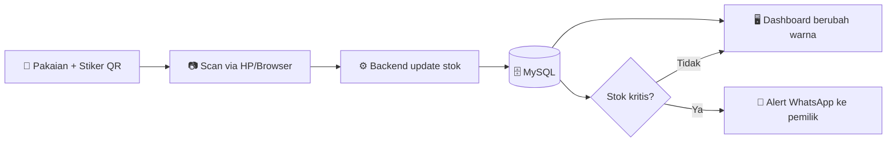

<div align="center">

# 👗 Yunda Fashion Digital Twin

### Monitoring Stok & Etalase Digital Real-Time untuk UMKM

_Scan QR → stok terupdate → etalase digital berubah warna → alert WhatsApp otomatis._


[Demo](#️-demo) · [Fitur](#-fitur-utama) · [Instalasi](#-instalasi) · [Cara Kerja](#-cara-kerja) · [Kontribusi](#-alur-kontribusi)

</div>

---

## 📖 Tentang Project

Project ini dibuat untuk tugas mata kuliah **Manajemen Proyek Perangkat Lunak (MPPL)** dengan studi kasus **Yunda Fashion**, toko pakaian wanita yang menjual Kemeja, Blus, Gamis, Rok, Celana Jeans, Celana Kain, Manset, dan Lejing.

### Masalah yang diselesaikan

| # | Masalah | Solusi di sistem ini |
|---|---------|----------------------|
| 1 | Data stok tidak akurat karena dicek manual per ukuran dan warna | Setiap varian punya QR Code unik, stok tercatat lewat scan |
| 2 | Best-seller sering habis tanpa disadari (stockout) | Smart Alert WhatsApp saat stok kritis |
| 3 | Tidak ada visibilitas etalase secara real-time | Dashboard Digital Twin dengan indikator warna live |

---

## ✨ Fitur Utama

- 🏷️ **QR Generator**: QR Code unik untuk setiap varian (jenis, ukuran, warna).
- 📷 **Web Scanner**: scan barang masuk/keluar langsung dari kamera HP atau browser, tanpa install aplikasi.
- 🟩🟨🟥 **Dashboard Digital Twin**: etalase virtual yang warnanya berubah live sesuai kondisi stok.
- 💬 **Smart Alert WhatsApp**: notifikasi otomatis ke pemilik toko saat stok menyentuh status merah.
- 🧾 **Riwayat Stok**: log setiap barang masuk dan keluar beserta waktunya.

### Indikator Status Stok

| Warna | Status | Jumlah Stok |
|:-----:|--------|-------------|
| 🟢 Hijau | Aman | lebih dari 5 pcs |
| 🟡 Kuning | Menipis | 2 sampai 5 pcs |
| 🔴 Merah | Kritis / Habis | kurang dari 2 pcs (memicu alert WhatsApp) |

---

## 🖼️ Demo

> Ganti bagian ini dengan screenshot atau GIF aplikasi.

| Dashboard Etalase | Web Scanner | Alert WhatsApp |
|:-----------------:|:-----------:|:--------------:|
|  |  |  |

---

## 🔄 Cara Kerja



---

## 🧰 Tech Stack

| Bagian | Teknologi |
|--------|-----------|
| Frontend | HTML5, CSS3, JavaScript, Bootstrap / Tailwind CSS |
| Backend | PHP / Node.js (Express) |
| Database | MySQL (XAMPP) |
| QR Scanner | [html5-qrcode](https://github.com/mebjas/html5-qrcode) |
| Notifikasi | [whatsapp-web.js](https://github.com/pedroslopez/whatsapp-web.js) / WA Gateway (Fonnte) |
| Version Control | Git & GitHub |

---

## 📁 Struktur Folder

```
yunda-fashion-digital-twin/
├── frontend/          # Tampilan dashboard & scanner
│   ├── index.html
│   ├── scanner.html
│   ├── css/
│   └── js/
├── backend/           # API, logika stok, integrasi WhatsApp
│   ├── routes/
│   ├── config/
│   └── server.js
├── database/
│   └── yunda_fashion.sql   # Skema & data awal
├── docs/              # Dokumentasi & screenshot
├── .env.example
└── README.md
```

> Sesuaikan dengan struktur folder yang sebenarnya dipakai tim.

---

## 🚀 Instalasi

### Prasyarat

- [XAMPP](https://www.apachefriends.org/) (Apache + MySQL)
- [Node.js](https://nodejs.org/) versi LTS
- Git
- Nomor WhatsApp aktif untuk pengirim alert

### Langkah

```bash
# 1. Clone repository
git clone https://github.com/<username>/yunda-fashion-digital-twin.git
cd yunda-fashion-digital-twin

# 2. Install dependency backend
cd backend
npm install

# 3. Salin file environment lalu isi sesuai konfigurasi
cp .env.example .env
```

**4. Siapkan database**

1. Jalankan **Apache** dan **MySQL** di XAMPP.
2. Buka `http://localhost/phpmyadmin`.
3. Buat database baru, misalnya `yunda_fashion`.
4. Import file `database/yunda_fashion.sql`.

**5. Jalankan aplikasi**

```bash
npm start
```

Lalu buka `http://localhost:3000` di browser.

**6. Hubungkan WhatsApp**

Saat pertama dijalankan, scan QR yang muncul di terminal memakai WhatsApp pengirim.

### Contoh `.env`

```env
DB_HOST=localhost
DB_USER=root
DB_PASS=
DB_NAME=yunda_fashion
PORT=3000
OWNER_WA_NUMBER=62812xxxxxxx
```

---

## 🗓️ Roadmap (6 Sprint)

- [ ] **Sprint 1**: Analisis kebutuhan, desain database & wireframe, setup repository
- [ ] **Sprint 2**: Data master produk & QR Generator
- [ ] **Sprint 3**: Web Scanner barang masuk/keluar
- [ ] **Sprint 4**: Dashboard Digital Twin real-time
- [ ] **Sprint 5**: Smart Alert WhatsApp & integrasi modul
- [ ] **Sprint 6**: Testing, perbaikan bug, dokumentasi, demo akhir

---

## 🤝 Alur Kontribusi

Tim memakai **Git Feature Branching** dan **Pull Request Review**.

```
main          ← versi stabil
 └── development   ← gabungan pekerjaan berjalan
      ├── feature/qr-generator
      ├── feature/web-scanner
      ├── feature/dashboard-twin
      └── feature/wa-alert
```

1. Ambil update terbaru: `git checkout development && git pull`
2. Buat branch fitur: `git checkout -b feature/nama-fitur`
3. Commit dengan pesan yang jelas, misalnya `feat: tambah scan barang keluar`
4. Push, lalu buat **Pull Request** ke `development`
5. Minimal satu anggota lain me-review sebelum di-merge

### Format Pesan Commit

| Prefix | Fungsi |
|--------|--------|
| `feat:` | fitur baru |
| `fix:` | perbaikan bug |
| `docs:` | perubahan dokumentasi |
| `style:` | perubahan tampilan/format kode |
| `refactor:` | perapian kode tanpa ubah fungsi |

---

## 👥 Tim

Dikerjakan bersama oleh 4 orang mahasiswa Informatika dengan semangat saling bantu di setiap tahapan.

| Nama | Peran Utama | GitHub |
|------|-------------|--------|
| Arya Arfanda | Anggota Tim | [@username](https://github.com/username) |
| Nama Anggota 2 | Anggota Tim | [@username](https://github.com/username) |
| Nama Anggota 3 | Anggota Tim | [@username](https://github.com/username) |
| Nama Anggota 4 | Anggota Tim | [@username](https://github.com/username) |

---

## 📄 Lisensi

Didistribusikan di bawah lisensi **MIT**. Lihat file `LICENSE` untuk detailnya.

---

<div align="center">

⭐ Kalau project ini membantu, jangan lupa kasih bintang ya!

_Dibuat untuk tugas MPPL · Universitas Samudra_

</div>
